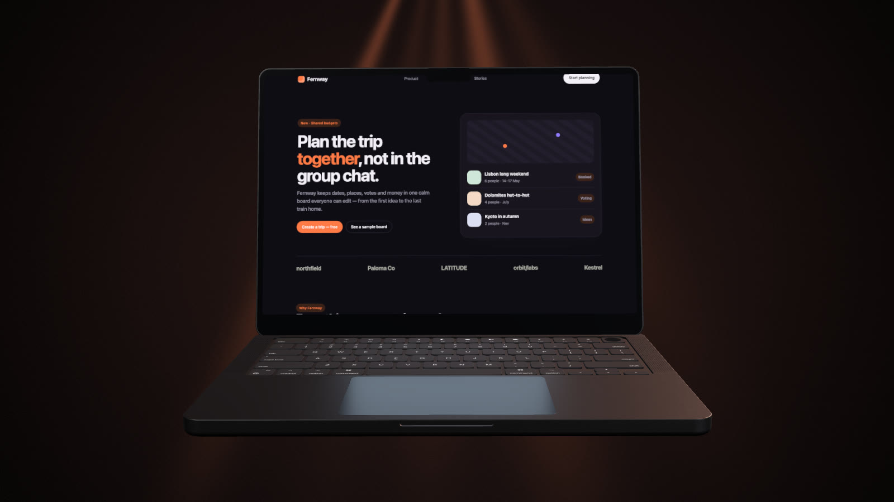
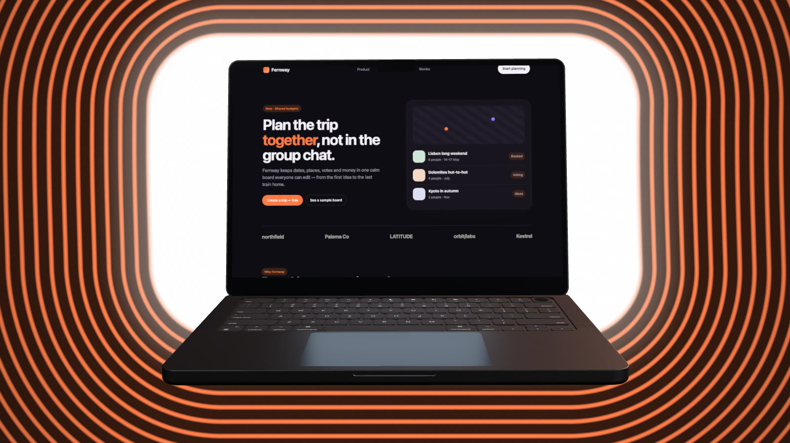
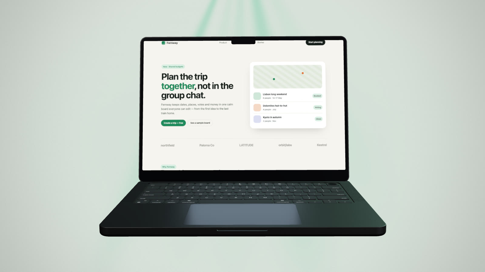

# Three.js product showcases

An agent skill for building 3D product showcase pages, and videos of them, with Three.js:

- **MacBook mockup.** A floating MacBook that scrolls a full website screenshot from top to bottom, or plays a video. The background is sampled from the screen content, so every page gets a set in its own colours.
- **Product turntable.** Any GLB product turning on a glossy white floor, with a real planar reflection and soft studio light.

Each page is a single HTML file that opens by double-click. A small Node tool renders any of them to a smooth 60 fps MP4, frame by frame.

| Dark page → orange beams | Same page, `--backdrop tunnel` | Light page → green beams |
| --- | --- | --- |
|  |  |  |

*The page on screen is [Fernway](examples/demo-site/), a fictional site made for these previews.*

## Install

### As a Claude Code plugin

```bash
/plugin marketplace add OWNER/threejs-product-skills
/plugin install threejs-product-showcases@threejs-product-skills
```

### As a plain skill

Copy `skills/threejs-product-showcases/` into `~/.claude/skills/` (personal) or `.claude/skills/` (one project).

Then ask for it in plain words: *"Make a video of my site https://… scrolling on a MacBook"* or *"Put this GLB on a turntable with a reflection."*

## Use it without an agent

Requirements:

- Python 3.10+ and ffmpeg (for screenshots);
- Node 18+ and Google Chrome (for capture and video export; set `CHROME_PATH` to use another Chromium);
- internet on first open, for the Three.js CDN.

```bash
cd skills/threejs-product-showcases
(cd tools && npm install)

# 1. Capture a page (only sites you may show)
node tools/capture-page.mjs https://your-site.example page.png

# 2. Build the mockup
python3 macbook-showcase/build.py --screenshot page.png --out mockup.html
open mockup.html

# 3. Render a video that ends when the page reaches the bottom
node tools/render-video.mjs mockup.html mockup.mp4
```

Mockup options: `--backdrop beams|tunnel|gradient`, `--accent '#hex'`, `--base '#hex'`, `--theme dark|light`, `--scroll-speed 250`, `--video demo.mp4` instead of `--screenshot`.

Turntable:

```bash
python3 product-turntable/build.py --model product.glb --pivot base --finish glossy --out turntable.html
node tools/render-video.mjs turntable.html turntable.mp4   # one seamless revolution
```

## What's inside

```
skills/threejs-product-showcases/
├── SKILL.md                 # what the agent reads first
├── macbook-showcase/        # template, build.py, the MacBook model
├── product-turntable/       # template, build.py
├── tools/                   # capture-page.mjs, render-video.mjs
└── references/              # technical notes, backdrops and colour, video export, QA
```

The technical notes record the parts that are easy to get wrong:

- the MacBook's hinge and screen UVs;
- tiling tall pages under the GPU texture limit;
- a constant-speed scroll profile;
- reflections without the mirrored-clone trap;
- finding a product's real spin axis;
- keeping every frame a pure function of time.

## Notes

- The MacBook model (`macbook-showcase/assets/macbook.glb`) is the only bundled asset. Bring your own screenshots, videos and product models.
- Three.js 0.180.0 is loaded from jsDelivr.

## License

[MIT](LICENSE). The license covers the code and documentation in this repo. The MacBook model is a third-party asset: check its terms before you redistribute it.
